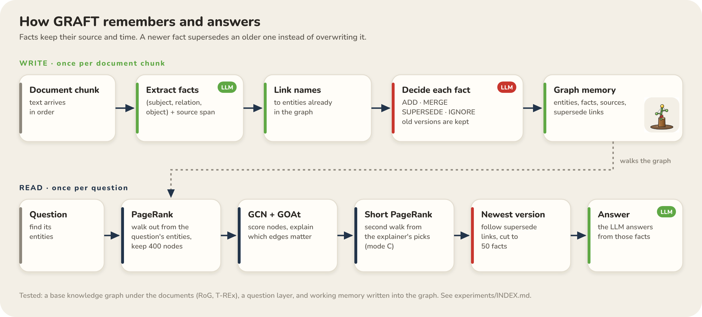
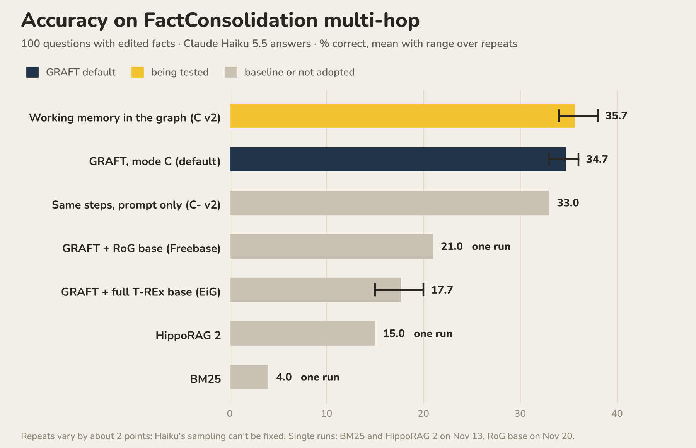

<p align="center">
  
</p>

<h1 align="center">GRAFT</h1>

<p align="center"><b>Revision-aware graph memory for LLM agents.</b><br>
New knowledge is grafted onto a graph that remembers where every fact came from and which version is newest.</p>

<p align="center">
  
  
  
  
</p>

---

Most agent memories either append text or overwrite it. GRAFT stores what an agent reads as a graph of facts. Every fact keeps its source and time, and when a newer fact contradicts an older one, the old one is **superseded, not deleted**. So the agent can always answer with the newest version, and still show how it got there.

## 🌱 The idea

GRAFT is built in three layers, like grafting branches onto a tree:

| Layer | What it holds | Status |
|---|---|---|
| **1 · Base** | General knowledge about how facts connect | as facts in the graph it hurts (RoG, full T-REx); as a structure guide (relations, types, common chains, never facts) it lifts GRAFT by 11 points |
| **2 · Documents** | Facts extracted from what the agent reads, linked into the graph | the core of GRAFT, in use |
| **3 · Questions and work** | The question, its sub-steps and notes, written into the graph while answering | being tested (working memory) |

## 🧭 How it works

<p align="center"></p>

**Write**, once per document chunk: an LLM extracts facts with their source span, names are linked to entities already in the graph, and each fact is added, merged with an existing one, marked as superseding an older version, or ignored.

**Read**, once per question: PageRank walks out from the question's entities and keeps the 400 most relevant nodes. A GCN scores them and GOAt explains which edges matter. A second, short walk starts from those picks (mode C). Supersede links are followed to the newest version, and the best 50 facts go to the LLM.

## 📊 Results so far

> FactConsolidation multi-hop from MemoryAgentBench: 100 questions whose answers depend on facts that were edited later in the documents. Claude Haiku 5.5 answers in every method.

<p align="center"></p>

| Method | Accuracy (%) | Repeats | Gold fact reached the model |
|---|---:|---:|---:|
| Working memory in the graph (C v2) | 35.7 (34–38) | 3 | 45 |
| **GRAFT + T-REx structure guide** | **45.7** (44–47) | 3 | 60 |
| GRAFT, mode C | 34.7 (33–36) | 6 | 51 |
| Same steps, prompt only (C- v2) | 33.0 | 3 | 41 |
| GRAFT + RoG base (Freebase) | 21 | 1 | 42 |
| GRAFT + full T-REx base (EiG) | 17.7 (15–20) | 3 | 33 |
| GRAFT + T-REx as background facts | 17.7 (16–19) | 3 | 33 |
| GRAFT + T-REx as a walk-only bridge | 17.3 (16–18) | 3 | 32 |
| HippoRAG 2 | 15 | 1 | – |
| BM25 | 4 | 1 | 32 |

**Takeaways**
- Using T-REx only as a guide to how facts connect (which relations chain together, what type each name is), never as facts, lifts GRAFT from 34.7 to 45.7 and brings the gold fact to the model on 60 of 100 questions instead of 51 ([test 06](experiments/test-06-trex-structure-guide/README.md)).
- GRAFT beats both baselines by a wide margin. Retrieval is still the limit.
- T-REx **as facts** hurts in every role tried: as a base graph, as a walk-only bridge, or as labelled background (17 to 18). Real-world facts crowd out the edited document facts and sometimes contradict them ([why](experiments/test-04-base-graph-trex-full/runs/run-02/analysis/why_accuracy_halved.md)).
- Working memory in the graph is about level with mode C, but writing the steps **into the graph** beats keeping them in the prompt by 2.6 to 2.7 points in both rounds.
- A single run on Nov 13 scored 38. Today's Haiku scores about 34 on the exact same facts, so every comparison here is run on the same day ([drift check](experiments/test-07-haiku-drift/baseline_check.md), [canary](experiments/test-07-haiku-drift/haiku_canary.md)).

## 🧪 Experiments

Every test has a README (Question · Setup · Result · Decision · Revisions), its configs, its runs and a table. Old runs are never edited: a rerun is a new `run-NN`. Full list: [experiments/INDEX.md](experiments/INDEX.md).

| Test | Question | Result | Decision |
|---|---|---|---|
| [01](experiments/test-01-read-order/README.md) | Which read order and starting graph? | A, B, C and D within a point | mode C is the default |
| [02](experiments/test-02-retrieval-variants/README.md) | Does any retrieval add-on help mode C? | none beat it | mode C with GOAt stays |
| [03](experiments/test-03-base-graph-rog/README.md) | Does a small Freebase base help? | 21 vs 38 | not adopted |
| [04](experiments/test-04-base-graph-trex-full/README.md) | Does the full T-REx base help? | 17.7 vs 34.7 | not adopted |
| [05](experiments/test-05-working-memory/README.md) | Does working memory in the graph help? | 35.7 vs 34.7, inside the spread | not kept on Haiku; Qwen pending |
| [06](experiments/test-06-trex-structure-guide/README.md) | T-REx as a guide, a bridge, or labelled background? | guide 45.7 vs 34.7; bridge 17.3; background 17.7 | guide kept on Haiku; Qwen next |
| [07](experiments/test-07-haiku-drift/README.md) | Did Haiku's behaviour drift? | same facts, 38 then about 34 | compare on the same day; canary in every paid batch |

## 🗺️ Status

- [x] Write and read paths with provenance and supersede links
- [x] Read order and retrieval variants (tests 01–02)
- [x] Base graph from RoG and full T-REx (tests 03–04)
- [x] Working memory, two rounds on Haiku (test 05)
- [ ] Working memory on Qwen
- [x] T-REx as a guide, a bridge, or background, on Haiku (test 06)
- [ ] The T-REx guide on Qwen
- [ ] GRAFT as the Memory route in Flotilla

## 📁 What's where

| Path | What it holds |
|---|---|
| `my_method/` | GRAFT itself: writer, graph store, retrieval, GNN and explainers |
| `eval/` | Runner, scoring and result tables |
| `baselines/` | BM25, HippoRAG 2, Mem0, Letta, long context, and MemoryAgentBench (submodule, unmodified) |
| `configs/` | Run configs |
| `experiments/` | Numbered tests, each with README, config, runs and table |
| `docs/design/` | Designs written before the code; `docs/design/theme/` holds the logo, diagram and chart sources |
| `assets/` | README images (built from the sources in `docs/design/theme/`) |
| `results/` | Raw runs, checkpoints, tables and figures |
| `scripts/` | Cluster jobs (Fir, Nibi, Trillium) and tools |
| `tests/` | Offline tests, no API calls |
| `ui/` | Streamlit control panel |

Setup, fake mode and the full pipeline are in [docs/USAGE.md](docs/USAGE.md). GRAFT was called **SGAR** during development; some files and configs keep that name so recorded runs stay reproducible.

## Built on

GRAFT's explainer step uses **GOAt** (Lu et al., ICLR 2024; https://github.com/sluxsr/GOAt) and, as an option,
**EiG-Search** (Lu et al., ICML 2024; https://github.com/sluxsr/EiG-Search). Benchmark data and baselines come from
**MemoryAgentBench** (https://github.com/HUST-AI-HYZ/MemoryAgentBench). GOAt and MemoryAgentBench are git
submodules and keep their own terms; see `NOTICE` for full citations.

```bibtex
@inproceedings{lu2024goat,
  title     = {{GOAt}: Explaining Graph Neural Networks via Graph Output Attribution},
  author    = {Shengyao Lu and Keith G. Mills and Jiao He and Bang Liu and Di Niu},
  booktitle = {The Twelfth International Conference on Learning Representations},
  year      = {2024}
}
@inproceedings{lu2024eig,
  title     = {{EiG-Search}: Generating Edge-Induced Subgraphs for {GNN} Explanation in Linear Time},
  author    = {Shengyao Lu and Bang Liu and Keith G Mills and Jiao He and Di Niu},
  booktitle = {Forty-first International Conference on Machine Learning},
  year      = {2024}
}
```

## License

Apache License 2.0, copyright 2026 Mohamed Khaled. See [`LICENSE`](LICENSE) and [`NOTICE`](NOTICE). Earlier versions
were MIT-licensed. The MemoryAgentBench and GOAt submodules and the baselines keep their own terms.

Paper this builds on: Hu, Wang & McAuley, *Evaluating Memory in LLM Agents via Incremental Multi-Turn Interactions* (MemoryAgentBench), ICLR 2026, arXiv 2507.05257.
