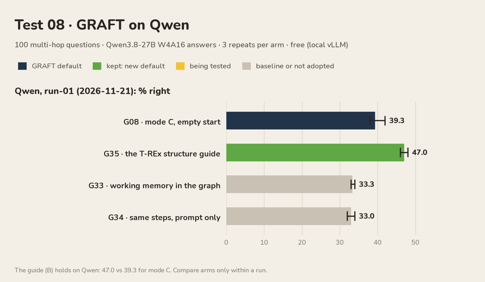

# Test 08 · GRAFT on Qwen

| Test | Date | Status | Current run |
|---|---|---|---|
| 08 | 2026-11-21 | run-01 done, run-02 (arm E) running | [run-01](runs/run-01/) |

## Candidates and setups

IDs from the [registry](../../docs/REGISTRY.md) (frozen 2026-11-21). A candidate is the method, a setup is the candidate plus model,
answer cap, benchmark and scoring; old run folders keep their names.

| Candidate | Setup | Row in this test |
|---|---|---|
| G08 | S18 | mode C, empty start |
| G33 | S60 | working memory in the graph |
| G34 | S63 | same steps, prompt only |
| G35 | S66 | the T-REx structure guide |

## Question

Flotilla ships with Qwen3.8-27B (W4A16, local vLLM), not Haiku, and its Memory routes call GRAFT with Qwen. Do GRAFT's
results on Haiku carry over to Qwen: mode C as the baseline, the T-REx structure guide (test 06 arm B), and working
memory in the graph against the same steps in the prompt only (test 05 C v2 and C- v2)?

## Setup

The same 100 FactConsolidation multi-hop questions (262K), the empty-start document graph, mode C (`ppr_goat_ppr`) with
GOAt, the same prompts as the Haiku arms, 256-token answers, 3 repeats per arm. Qwen3.8-27B W4A16 is served by vLLM
on one 3g.40gb MIG slice of an H100 (Nibi) inside the same job (`scripts/nibi/run_qwen_graft.sbatch`, reasoning parser
qwen3); GRAFT's gateway calls it through its local backend. Free: no API spend.

| Arm | What | Config |
|---|---|---|
| A | mode C, one answer call | [a_modec_empty.yaml](../../configs/runs/exp/qwen/a_modec_empty.yaml) |
| B | the T-REx structure guide (linking + planning) | [b_guide_empty.yaml](../../configs/runs/exp/qwen/b_guide_empty.yaml) |
| C v2 | working memory written into the graph, newer-fact step prompt | [c_wm_graph_v2_empty.yaml](../../configs/runs/exp/qwen/c_wm_graph_v2_empty.yaml) |
| C- v2 | the same steps, prompt only | [cm_wm_prompt_v2_empty.yaml](../../configs/runs/exp/qwen/cm_wm_prompt_v2_empty.yaml) |
| E (run-02) | the guide + working memory in the graph (C v2), same job as a guide rerun | [e_guide_wm_v2_empty.yaml](../../configs/runs/exp/qwen/e_guide_wm_v2_empty.yaml), [b_guide_sameday_empty.yaml](../../configs/runs/exp/qwen/b_guide_sameday_empty.yaml) |

## Result

run-01, Nibi 28263641 (2026-11-21, one job, all four arms in turn: A 22 min, B 21 min, C v2 150 min, C- v2 72 min),
[table.csv](table.csv) built by `make_table.py` from the runs:

| Arm | Accuracy (mean, SD) | Per repeat | Gold fact in final facts | Answers cut at 256 tokens |
|---|---|---|---|---|
| A · mode C | 39.3, 2.3 | 42 / 38 / 38 | 50.7 | 35.3% |
| B · the T-REx structure guide | **47.0**, 1.0 | 48 / 46 / 47 | 59.0 | 26.3% |
| C v2 · working memory in the graph | 33.3, 0.6 | 33 / 34 / 33 | 40.3 | 0% |
| C- v2 · same steps, prompt only | 33.0, 1.0 | 32 / 34 / 33 | 39.0 | 0% |

The guide carries over: +7.7 points over mode C on Qwen (+11 and +12 on Haiku), and it brings the gold fact to the
model for about 8 more questions in 100. Qwen with mode C alone scores 39.3, above Haiku's 34-35 the same week.
Working memory falls below mode C on Qwen, and here writing the steps into the graph is level with keeping them in the
prompt (33.3 vs 33.0), where Haiku showed a 2.6-2.7 point gap in two rounds.

A caveat on the one-call arms: Qwen often reasons step by step in its answer, and 35% (A) and 26% (B) of its answers
reached the 256-token cap before a final answer; 6 and 5 of those cut answers in repeat 0 were still scored right. The
cap is the same for every arm and model (set in test 01), so arms compare fairly within
Qwen, but Qwen's absolute numbers on A and B are lower bounds. The working-memory arms answer through short steps and
are never cut.

## Decision

The guide stays GRAFT's default on Qwen too, and the Memory routes keep using it. Working memory is parked, not
dropped (test 06); run-02 tests the guide plus working memory (arm E) on Qwen against a guide rerun in the same job.

## Revisions

- 2026-11-21: run-02 submitted, arm E on Qwen with a same-job guide rerun (Fir 5088060 and Nibi 28366021 as twins).
- 2026-11-21: run-01 recorded. Its four folders are named `_j28252727`, the job that failed on the missing `openai`
  package before it answered anything, but every result in them was written by Nibi 28263641: its `owner.json` names
  28263641, and the queue log `results/queues/slurm_28263641.jsonl` lists these folders as its run dirs. The rerun had
  resumed the dead job's empty folders. The folders keep their names (old runs are never edited); `eval/run.py` now
  resumes only the same Slurm job's folder, so a rerun always gets a new folder named after its own job (tested in
  `tests/test_run_owner.py`).
